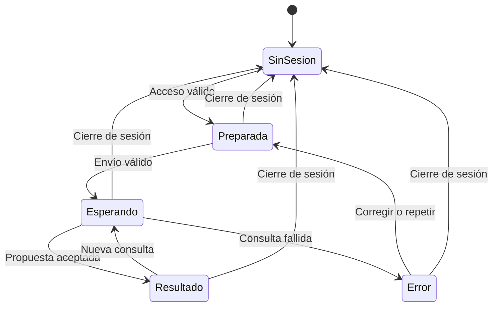

# Datos temporales de App 2

Este documento describe los datos de la consulta. No es un esquema de base de datos: no habrá tablas ni almacenamiento de resultados.

## Selección

| Campo | Tipo y regla |
| --- | --- |
| `objeto` | Identificador de uno de los 58 objetos del anexo A de la ERS. |
| `encantamientos` | Lista de 1 a 8 elementos distintos. |
| `nombre` | Identificador de uno de los 39 encantamientos, permitido para el objeto. |
| `nivel` | Entero estricto desde 1 hasta el máximo del encantamiento. |

Se rechazan datos ausentes, campos adicionales, duplicados e incompatibilidades. Un texto o un booleano no se convierte en nivel. Cada encantamiento de la selección representa un libro nuevo y conserva el nivel elegido.

## Elementos disponibles

Al comenzar existen `objeto` y tantos `libro_N` como encantamientos. Los libros siguen el orden de la selección.

Cada elemento mantiene temporalmente su referencia, su nombre para mostrar, los libros que contiene y si contiene el objeto. Al combinar dos elementos se retiran ambos y se crea `paso_N`. Solo se puede usar una referencia disponible y cada referencia se consume una vez.

Por ejemplo, combinar `libro_1` y `libro_2` crea `paso_1`, que contiene ambos libros. Después se puede combinar `objeto` con `paso_1`. El objeto o el resultado que lo contiene siempre va a la izquierda.

## Paso y propuesta

| Campo | Regla |
| --- | --- |
| `orden` | Entero consecutivo desde 1. |
| `izquierda`, `derecha` | Dos referencias distintas disponibles. Tras comprobarlas se convierten en nombres comprensibles. |
| `coste_niveles` | Entero no negativo estimado por la IA. |
| `pasos` | Con N libros debe haber exactamente N pasos. |
| `coste_total_niveles` | Entero no negativo, igual a la suma de los costes. |
| `advertencias` | Lista de textos que puede estar vacía. Desde 40 niveles por paso se añade el aviso de supervivencia. Los costes se presentan como estimados en las etiquetas de la pantalla. |

Al terminar debe quedar un solo elemento con el objeto y todos los libros iniciales. Se rechaza la propuesta completa si no se cumple alguna regla. No se recalcula el coste real del juego.

## Sesión y errores

La sesión se acredita con el token de Clerk en el encabezado de la petición. El backend comprueba su firma, vigencia, emisor y las condiciones de origen o audiencia aplicables. No se envía el token al proveedor de IA ni se conserva como dato de la consulta.

Los errores tienen `codigo` y `mensaje`, según el [contrato HTTP](contracts/http.md). El mensaje no contiene tokens, claves, entradas ni respuestas completas del proveedor.

## Estados de la pantalla

Mientras se espera no se permite otro envío ni editar la selección. El cierre de sesión sigue disponible: retira los datos, cancela la espera local e impide que una respuesta tardía vuelva a mostrarse. Una recarga empieza con datos funcionales vacíos, aunque Clerk pueda conservar su sesión técnica.
