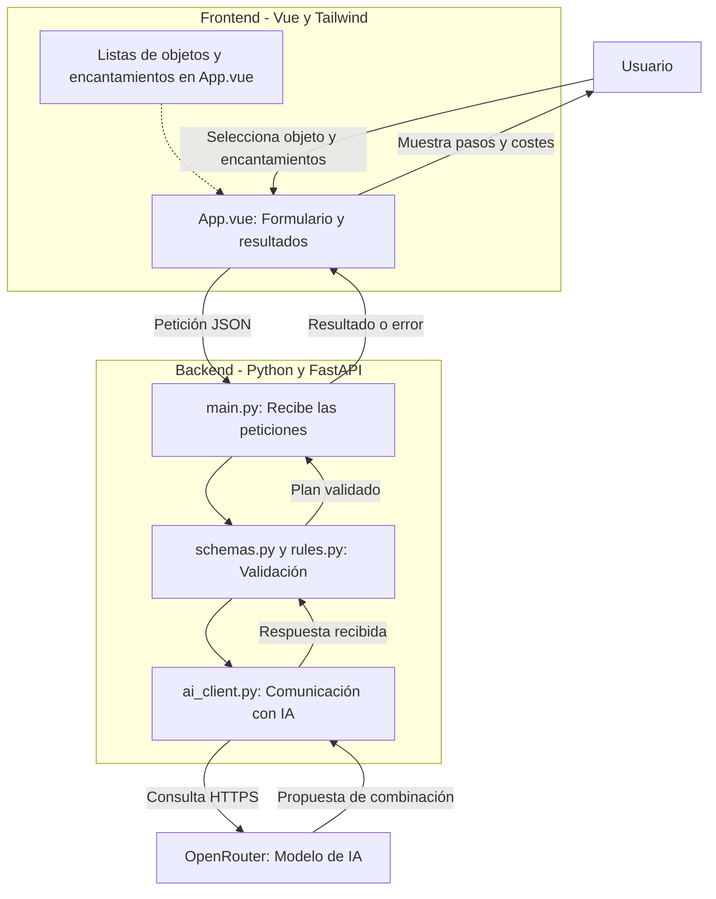
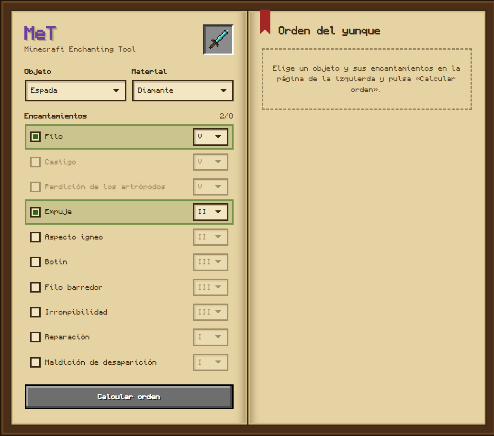
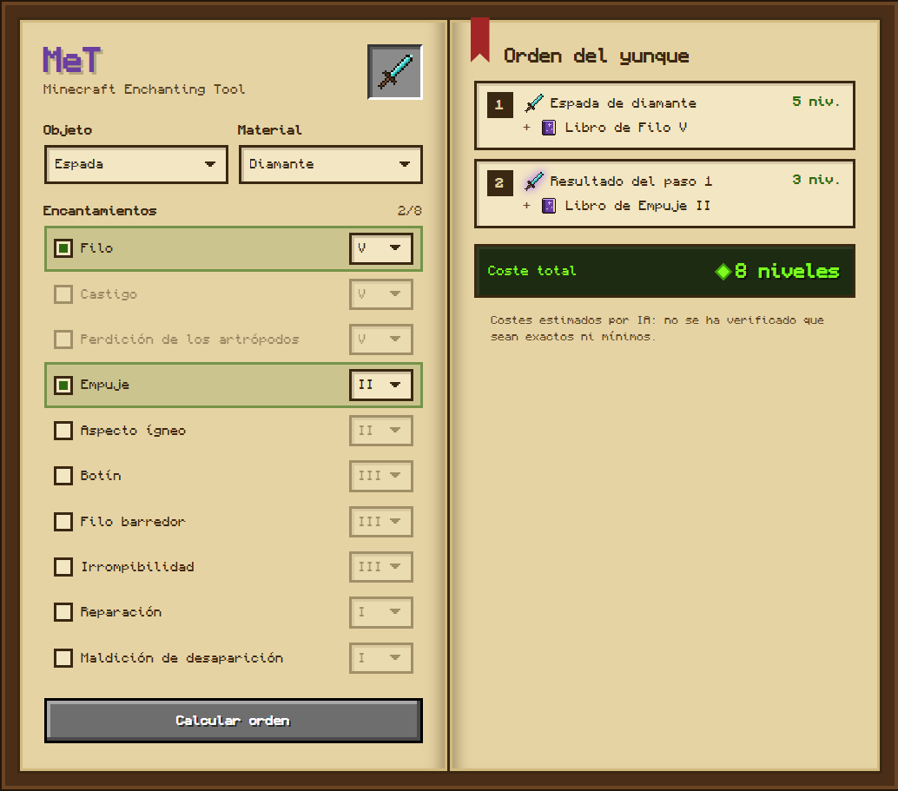
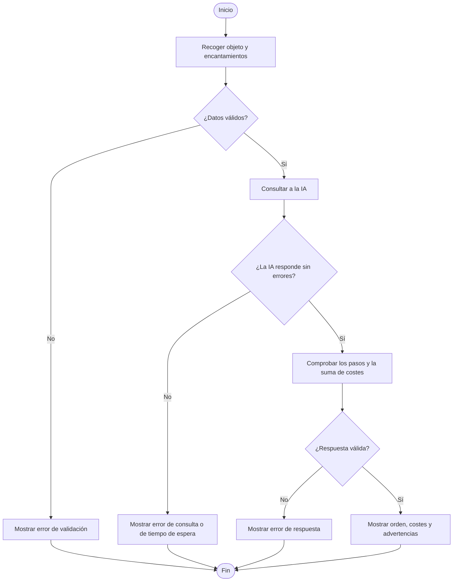

# Especificación de Requisitos del Software (ERS)

## Datos del documento

| Campo | Información |
|---|---|
| Proyecto | MeT — Minecraft Enchanting Tool (App 1) |
| Autores | Jesús Pérez Marinetto y Hugo Cáceres Martín |
| Curso | Especialización en Aprendizaje automático: gestión de datos y entrenamiento |
| Asignatura | Desarrollo de componentes software para sistemas de aprendizaje automático |
| Docente y grupo | Pendiente de completar |
| Fecha | 13/10/2026 |
| Versión | 0.2 |
| Estado | Documentación de App 1 |

### Historial de cambios

| Versión | Fecha | Cambio |
|---|---|---|
| 0.1 | 12/10/2026 | Primera versión de la ERS. |
| 0.2 | 13/10/2026 | Se simplifica la redacción y se da más importancia al análisis del problema, su división en partes y los diagramas. Revisión realizada con apoyo de IA. |

## 1. Introducción

### 1.1. Propósito del documento

En este documento explicamos qué problema queremos resolver con MeT, cómo hemos dividido el funcionamiento de la aplicación y qué requisitos tiene que cumplir. Nos servirá como guía para desarrollar y comprobar la App 1.

### 1.2. Problema y objetivos

Cuando queremos poner varios libros encantados a un objeto de Minecraft, el orden en el que los combinamos en el yunque influye en el coste. Hacerlo en un orden poco conveniente puede hacer que gastemos más niveles de los necesarios.

Nuestra idea es crear una web en la que el jugador seleccione un objeto y los encantamientos que quiere añadir. La aplicación le propondrá un orden de combinación con sus pasos y el coste estimado.

| ID | Objetivo | Cómo comprobaremos que se cumple |
|---|---|---|
| OBJ-01 | Proponer un orden de combinación para los encantamientos elegidos. | Se muestran los pasos y sus costes. |
| OBJ-02 | Evitar combinaciones que no sean válidas. | Se rechazan los encantamientos incompatibles o que no correspondan al objeto. |
| OBJ-03 | Conectar la web con el backend y una API de IA. | Una petición válida llega a la IA y su respuesta se muestra en pantalla. |


### 1.3. Alcance

La App 1 tendrá una sola pantalla. El usuario podrá elegir un objeto, añadir entre 1 y 8 encantamientos con sus niveles y consultar el orden propuesto para combinarlos.

Nos centraremos en Minecraft Java, con objetos nuevos y libros que tengan un encantamiento cada uno. No tendremos usuarios registrados, base de datos ni historial. Tampoco incluiremos la reparación o el cambio de nombre de objetos.

### 1.4. Definiciones

| Término | Significado |
|---|---|
| ERS | Documento donde recogemos lo que tiene que hacer la aplicación. |
| Frontend | Parte de la web que utiliza y ve el jugador. |
| Backend | Parte que comprueba los datos y hace la consulta a la IA. |
| API | Forma de comunicación entre la aplicación y otro servicio. |
| JSON | Formato que usamos para enviar y recibir datos. |
| Mock | Respuesta simulada que usamos para hacer pruebas sin llamar a la IA real. |

### 1.5. Referencias

Para preparar esta ERS hemos partido del enunciado de la práctica, de `plantillaERS.md`, del contrato de la API (`contrato-api.md`) y de los archivos actuales de App 1. Los requisitos se revisarán si cambia el funcionamiento acordado.

## 2. Descripción general del sistema

### 2.1. Cómo se organiza la aplicación

La aplicación se divide en tres partes principales:

- **Frontend (Vue y Tailwind):** permite seleccionar el objeto y los encantamientos y muestra el resultado.
- **Backend (Python y FastAPI):** recibe la solicitud, comprueba los datos y prepara la respuesta.
- **OpenRouter:** es el servicio externo al que el backend consulta para obtener una propuesta de combinación mediante IA.

El usuario no se comunica directamente con OpenRouter. Lo hace a través del backend, donde se guarda la clave privada del servicio.





### 2.2. Usuarios

La aplicación está pensada para jugadores de Minecraft que quieran calcular el orden de sus encantamientos. No hace falta registrarse ni tener conocimientos de programación.

El equipo de desarrollo se encargará del formulario, las validaciones, la conexión con la IA y las pruebas. El docente revisará el trabajo y su funcionamiento.

### 2.3. División del problema en partes

Para que el problema sea más sencillo de resolver, lo hemos separado en pequeñas tareas. Partimos del objetivo general y lo dividimos en lo que debe hacer cada parte:

| Parte | Qué hace | Dónde se realiza |
|---|---|---|
| 1. Selección | Recoger el objeto, los encantamientos y sus niveles. | Frontend |
| 2. Validación | Comprobar los límites y si los encantamientos se pueden combinar. | Backend |
| 3. Consulta | Pedir a la IA una propuesta de orden. | Backend y OpenRouter |
| 4. Comprobación | Revisar que la respuesta tenga pasos válidos y que los costes sumen correctamente. | Backend |
| 5. Resultado | Mostrar el orden, el coste total o un mensaje de error. | Frontend |

De esta forma podemos trabajar y probar cada parte por separado. También es más fácil encontrar un fallo, ya que sabemos en qué punto de la aplicación se produce.


### 2.4. Entorno de uso

La web se podrá utilizar desde un navegador de ordenador o móvil. Para hacer consultas reales será necesaria una conexión a Internet. El proyecto se desarrolla en local y su publicación está prevista en Vercel.

### 2.5. Restricciones

- Una sola pantalla, un formulario y una función principal.
- Frontend con Vue y Tailwind; backend con Python y FastAPI.
- Una única API de IA, consultada una vez por solicitud válida en modo real.
- Sin base de datos ni almacenamiento de las consultas.
- La clave de OpenRouter solo estará configurada en el backend.
- Se utilizarán GitHub, pytest y Vercel según lo indicado en la práctica.

### 2.6. Dependencias y suposiciones

Dependemos de que OpenRouter funcione y de tener una clave con acceso al modelo elegido. Si el servicio falla, la aplicación debe mostrar un error en lugar de inventarse una respuesta.

También partimos de que el objeto no tiene encantamientos anteriores y que los libros son nuevos. 
## 3. Requisitos funcionales

### 3.1. Lista de requisitos

| ID | Requisito | Prioridad |
|---|---|---|
| RF-01 | Elegir objeto y encantamientos. | Alta |
| RF-02 | Validar la selección. | Alta |
| RF-03 | Consultar a la IA. | Alta |
| RF-04 | Comprobar la respuesta. | Alta |
| RF-05 | Mostrar el resultado. | Alta |
| RF-06 | Informar de los errores. | Alta |

### 3.2. Descripción y comprobación

#### RF-01. Elegir objeto y encantamientos

El usuario podrá elegir un objeto y entre 1 y 8 encantamientos con sus niveles desde el formulario.

**Comprobación:** con una espada y dos encantamientos válidos se puede enviar la selección. Si faltan datos, el formulario avisa y no envía la petición.

#### RF-02. Validar la selección

El backend comprobará que los encantamientos existan, que sus niveles sean correctos y que se puedan aplicar al objeto. También rechazará encantamientos repetidos o incompatibles entre sí. Solo aceptará los nombres de las listas y niveles enteros, sin texto libre ni campos adicionales, aunque la petición se envíe sin usar el formulario.

**Comprobación:** una combinación de Filo y Castigo, o un encantamiento de botas en una espada, produce un error sin consultar a la IA. Lo mismo ocurre si se intenta introducir una instrucción en el objeto, en un encantamiento o en un campo adicional.

#### RF-03. Consultar a la IA

Si los datos son válidos, el backend realizará una petición a OpenRouter para pedir una propuesta de combinación. No se harán consultas adicionales ni reintentos automáticos.

**Comprobación:** con una petición válida se realiza una sola llamada al proveedor. La prueba con la IA real sigue pendiente de completarse con éxito.

#### RF-04. Comprobar la respuesta

Antes de enviarla al usuario, el backend revisará que la propuesta tenga los pasos necesarios, que no reutilice libros y que el coste total coincida con la suma de cada paso.

**Comprobación:** si falta un libro, se repite uno o las cuentas no cuadran, el backend rechaza la respuesta. Esto no garantiza por sí solo que el coste sea el mínimo.

#### RF-05. Mostrar el resultado

La web mostrará en la misma pantalla el orden de combinación, los costes de cada paso, el coste total y las advertencias. Mientras espera, indicará que se está procesando la petición.

**Comprobación:** al recibir una respuesta correcta aparece el resultado sin cambiar de página ni crear un historial.

#### RF-06. Informar de los errores

Si hay datos incorrectos, falla la conexión o la IA no responde, se mostrará un mensaje claro. Después, el usuario podrá volver a intentarlo.

**Comprobación:** simulando estos fallos, el formulario deja de mostrar la espera y permite realizar otra consulta.

## 4. Requisitos no funcionales

| ID | Requisito | Cómo lo comprobaremos |
|---|---|---|
| RNF-01 | La consulta tendrá un tiempo máximo de espera configurado. | Simular una IA que no contesta y comprobar que se devuelve un error de tiempo agotado. El valor por defecto actual es 20 segundos. |
| RNF-02 | La aplicación no guardará las consultas ni expondrá las claves privadas. Los registros solo incluirán códigos de error y estados técnicos. | Revisar el código, la configuración, los registros y el almacenamiento del navegador. |
| RNF-03 | La página debe poder utilizarse en móvil y ordenador, también con teclado. | Probar el formulario y el resultado en distintos tamaños de pantalla y usando Tab. |
| RNF-04 | Debe funcionar en los navegadores previstos. | Probar el recorrido completo en Chrome y Edge cuando esté desplegada. |

## 5. Datos y reglas del problema

### 5.1. Datos que utilizamos

Para simplificar el problema, representamos los elementos del juego mediante datos:

| Dato | Qué contiene |
|---|---|
| Entrada | Objeto y lista de encantamientos, cada uno con su nivel. |
| Resultado | Pasos de combinación, coste de cada paso, coste total y advertencias. |
| Error | Código y mensaje que explican por qué no se ha podido realizar  la consulta. |

Esta representación nos permite trabajar con los encantamientos sin tener que reproducir el juego. La aplicación solo utiliza los datos durante la consulta y no los guarda en una base de datos.

### 5.2. Reglas que debe respetar el sistema

- **RN-01:** se selecciona un objeto y entre 1 y 8 encantamientos diferentes.
- **RN-02:** cada encantamiento debe ser válido para ese objeto y respetar su nivel máximo.
- **RN-03:** no se permiten encantamientos incompatibles, como Filo y Castigo o Fortuna y Toque de seda.
- **RN-04:** cada libro debe utilizarse una vez y el coste total debe coincidir con la suma de los pasos. Si un paso cuesta 40 niveles o más, se mostrará una advertencia.

Los costes que proponga la IA se muestran como estimaciones mientras no esté comprobado que coinciden con los del juego.

## 6. Interfaces

### 6.1. Interfaz de usuario

La aplicación tendrá una única pantalla con un selector de objeto, una zona para añadir encantamientos y sus niveles, y un botón para calcular. En la misma página se mostrarán la espera, los resultados o los errores.




### 6.2. Comunicación con otros sistemas

Cuando el usuario pulse el botón, el frontend enviará los datos en formato JSON al endpoint `POST /api/procesar` del backend. FastAPI validará la petición y, si es correcta, consultará OpenRouter por HTTPS.

El backend devolverá otro JSON con el resultado o un error. Los códigos principales son:

| Código HTTP | Significado |
|---|---|
| 200 | La petición se ha procesado y hay un plan válido en cuanto a su estructura. |
| 422 | La selección no es válida. |
| 502 | La IA ha fallado o ha devuelto una respuesta que no se puede utilizar. |
| 504 | Se ha superado el tiempo de espera. |

La App 1 no necesita inicio de sesión. La clave de OpenRouter se utiliza únicamente desde el backend.

## 7. Caso de uso y representación del algoritmo

### 7.1. Caso de uso: calcular encantamientos

El funcionamiento esperado es el siguiente:

1. El jugador selecciona el objeto y los encantamientos.
2. El frontend envía la selección al backend.
3. El backend comprueba que los datos son válidos.
4. Si todo está bien, consulta a OpenRouter.
5. El backend revisa la respuesta recibida.
6. El frontend muestra los pasos y su coste, o un mensaje de error si algo ha fallado.

Si la selección no es correcta, no se consulta a la IA. Si falla el proveedor, se informa al usuario para que pueda intentarlo de nuevo.

### 7.2. Pseudocódigo

Este pseudocódigo representa el funcionamiento general. No describe un algoritmo matemático que garantice el coste mínimo, porque actualmente la propuesta de orden se obtiene de la IA.

```text
INICIO
    Recoger objeto y encantamientos

    SI los datos no son válidos ENTONCES
        Mostrar error
    SINO
        Consultar a la IA

        SI la consulta falla ENTONCES
            Mostrar error
        SINO
            Comprobar los pasos y los costes recibidos

            SI la respuesta es válida ENTONCES
                Mostrar orden, costes y advertencias
            SINO
                Mostrar error de respuesta
            FIN SI
        FIN SI
    FIN SI
FIN
```

### 7.3. Diagrama de flujo

Este diagrama muestra las decisiones del pseudocódigo y cuándo se presenta el resultado o un mensaje de error.



## 8. Pruebas y comprobaciones

Para verificar el funcionamiento, relacionamos cada parte con una prueba sencilla. Se pueden hacer pruebas automáticas con pytest utilizando una IA simulada y pruebas manuales desde la web.

| Requisitos | Prueba | Resultado esperado |
|---|---|---|
| RF-01 y RF-02 | Enviar selecciones válidas de 1 y 8 encantamientos, una incompatible y otra que intente introducir instrucciones. | La válida continúa y la incorrecta se rechaza antes de llamar a la IA. |
| RF-03 | Simular una petición al proveedor y contar llamadas. | Una sola consulta por envío válido. |
| RF-04 | Probar un plan correcto y otro con libros repetidos o suma incorrecta. | Se acepta el primero y se rechaza el segundo. |
| RF-05 | Mostrar una respuesta y volver a consultar. | El resultado aparece en la misma pantalla, sin historial. |
| RF-06 y RNF-01 | Simular fallo de la IA y tiempo agotado. | Aparece un error y se permite repetir la consulta. |
| RNF-02 | Revisar código, configuración y registros. | No hay claves expuestas ni datos funcionales guardados. |
| RNF-03 y RNF-04 | Probar con, móvil, Chrome y Edge. | La interfaz se puede usar correctamente. |

Se han ampliado las pruebas del backend para comprobar las nuevas incompatibilidades, los intentos de introducir instrucciones y que los registros no guarden contenido de las consultas. Las pruebas usan respuestas simuladas, sin gastar créditos de OpenRouter. Esas pruebas no demuestran por sí solas que el orden sea el más barato ni que la conexión real con la IA y el despliegue estén terminados.

## 9. Cuestiones pendientes

| ID | Pendiente |
|---|---|
| PEN-01 |   |
## 10. Revisión y conformidad

### 10.1. Comprobaciones antes de entregar

- [ ] La descripción del problema coincide con lo que hace la aplicación.
- [ ] Los requisitos y las reglas están revisados por el equipo.
- [ ] Se han añadido los diagramas y capturas indicados.
- [ ] La conexión real con la IA y la publicación están comprobadas.
- [ ] Se han registrado las pruebas y se han resuelto o explicado las cuestiones pendientes.

### 10.2. Revisión

La revisión comprueba que los requisitos coinciden con el comportamiento de App 1 y con las pruebas realizadas.

## Anexos

### Anexo A. Ejemplo de entrada

Este es un ejemplo de los datos que enviamos al backend al elegir una espada de diamante con Filo V y Reparación I:

```json
{
  "objeto": "diamond_sword",
  "encantamientos": [
    {"nombre": "sharpness", "nivel": 5},
    {"nombre": "mending", "nivel": 1}
  ]
}
```

### Anexo B. Evidencias de funcionamiento

**[INSERTAR GRÁFICA: captura de una prueba de validación que muestre cómo se rechaza una combinación incorrecta.]**

Las capturas de la conexión real y de la aplicación desplegada se añadirán cuando se hayan comprobado. No deben utilizarse respuestas simuladas como prueba de que OpenRouter funciona correctamente.
