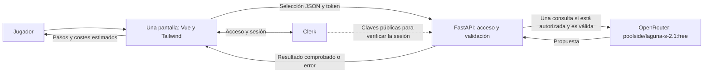
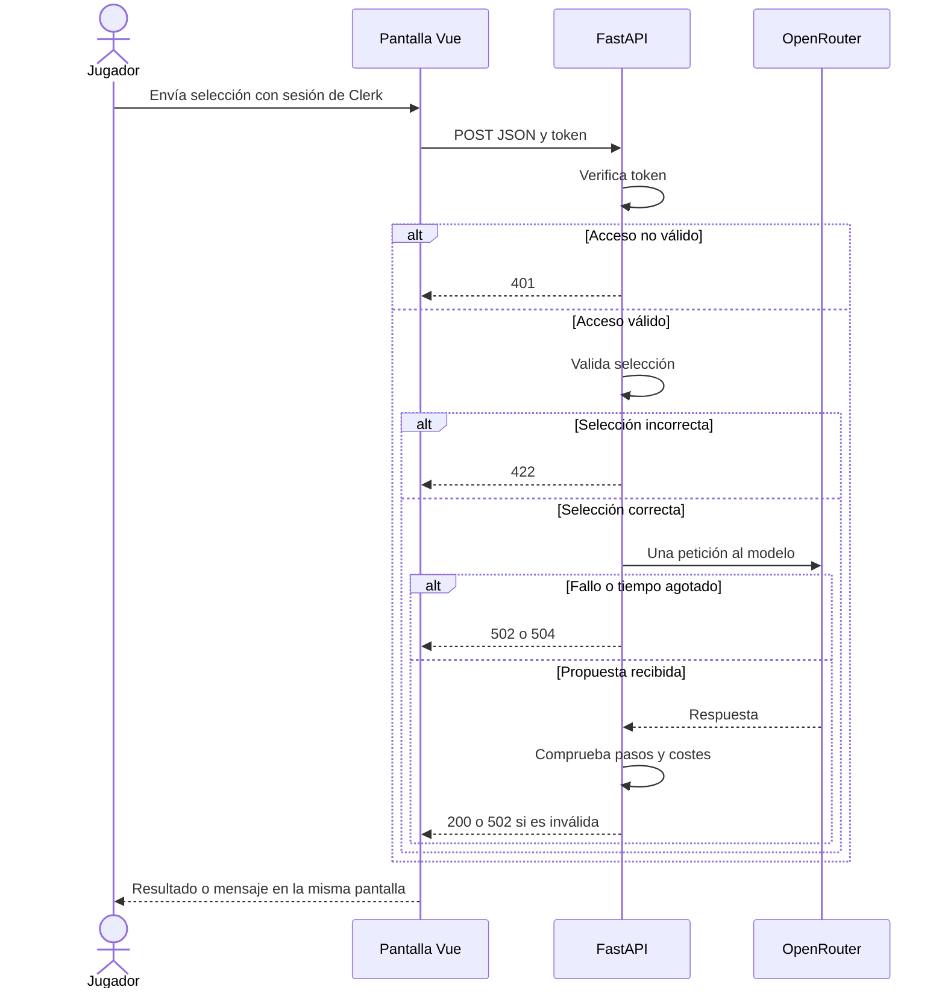

# Especificación de Requisitos del Software (ERS) — App 2

## Datos del documento

| Campo | Información |
|---|---|
| Proyecto | MeT — Minecraft Enchanting Tool (App 2) |
| Autores | Jesús Pérez Marinetto y Hugo Cáceres Martín |
| Curso y grupo | Especialización en Aprendizaje automático: gestión de datos y entrenamiento. Grupo pendiente de completar. |
| Asignatura | Desarrollo de componentes software para sistemas de aprendizaje automático |
| Docente | Pendiente de completar |
| Fecha | 19/10/2026 |
| Versión | 0.1 |
| Estado | Requisitos aceptados como base para la especificación de App 2 |

### Historial de cambios

| Versión | Fecha | Cambio |
|---|---|---|
| 0.1 | 19/10/2026 | Primera versión de la ERS de la App 2, preparada con apoyo de IA a partir de la plantilla, el enunciado y el análisis de la App 1. Se incorporan Clerk, el modelo elegido y los requisitos de despliegue. Se toma como referencia la lista más completa del backend. |

## 1. Introducción

### 1.1. Propósito del documento

En este documento recogemos lo que tiene que hacer la App 2 y cómo comprobaremos su funcionamiento. Nos servirá al equipo para preparar las especificaciones de Spec Kit y revisar el código que genere la IA. También permitirá al docente comprobar que el resultado cumple lo pedido en la práctica.

### 1.2. Problema y objetivos

Cuando queremos poner varios libros encantados a un objeto de Minecraft, el orden de las combinaciones en el yunque influye en los niveles que gastamos. MeT ayudará al jugador a consultar una propuesta de orden con sus pasos y costes estimados.

La App 2 resolverá la misma necesidad que la App 1, con una implementación nueva dirigida por Spec Kit. Añadirá el acceso mediante Clerk y se desplegará también con Docker en AWS.

| ID | Objetivo | Cómo comprobaremos que se cumple |
|---|---|---|
| OBJ-01 | Obtener una propuesta de combinación para un objeto y sus encantamientos. | Una selección válida produce pasos ordenados, costes y advertencias en la misma pantalla. |
| OBJ-02 | Evitar consultas con selecciones incorrectas. | El backend rechaza los casos inválidos sin llamar a la IA. |
| OBJ-03 | Permitir el procesamiento solo a usuarios autenticados. | Una petición con sesión válida continúa; una petición sin autorización devuelve 401 y no consulta a la IA. |
| OBJ-04 | Desarrollar una nueva implementación a partir de requisitos revisados. | La especificación, el plan y las tareas aparecen en Git antes que el código correspondiente. |
| OBJ-05 | Reproducir el funcionamiento en los entornos de la práctica. | El flujo se demuestra en Vercel, en Docker local y en AWS EC2. |

### 1.3. Alcance

La aplicación tendrá una pantalla, un formulario y una función: proponer un orden de combinación. El jugador elegirá un objeto y entre 1 y 8 encantamientos con sus niveles. El acceso con Clerk se integrará en esa pantalla o en una ventana modal.

Trabajaremos con Minecraft Java, objetos sin encantamientos previos y libros nuevos con un encantamiento cada uno. Las opciones serán las del anexo A, tomadas de las listas más completas del backend de la App 1. No fijamos una versión concreta del juego ni prometemos cubrir todos sus objetos y mecánicas.

La propuesta de la IA y sus costes se presentarán como estimaciones. Comprobar que los pasos tienen sentido y que las sumas cuadran no demuestra que el resultado sea el más barato posible ni que todos los costes coincidan con los del juego.

Quedan fuera del alcance:

- Reparar o renombrar objetos, usar objetos con trabajos anteriores de yunque, libros con varios encantamientos y combinar niveles para obtener otro mayor.
- Minecraft Bedrock y las opciones que no figuren en las listas acordadas.
- Bases de datos, historial, cachés y almacenamiento de entradas o resultados, también en archivos o en el navegador.
- CRUD, paneles, estadísticas, perfiles y gestión propia de usuarios.
- Pantallas adicionales, conversaciones con memoria, subida de archivos y otras funciones ajenas al formulario.
- Múltiples proveedores de IA, llamadas encadenadas y reintentos automáticos al proveedor.

### 1.4. Definiciones y abreviaturas

| Término | Significado |
|---|---|
| ERS | Documento donde recogemos lo que tiene que hacer la aplicación y cómo comprobarlo. |
| SPA | Web que muestra el formulario y el resultado en una misma pantalla. |
| Frontend | Parte de la web que ve y utiliza el jugador. |
| Backend | Parte que verifica el acceso, comprueba los datos y consulta a la IA. |
| API y JSON | Medio de comunicación entre servicios y formato usado para los datos de nuestra aplicación. |
| Clerk y token de sesión | Servicio externo de identidad y credencial temporal que permite comprobar el acceso. |
| Mock | Respuesta o servicio simulado que usamos en pruebas sin depender del servicio real. |
| Spec Kit | Herramientas que ayudan al agente a pasar de los requisitos a una especificación, un plan y tareas de desarrollo. |
| Docker y EC2 | Contenedores para ejecutar la aplicación y servidor de AWS donde los desplegaremos. |

### 1.5. Referencias y fuentes

| ID | Fuente | Fecha o versión | Ubicación |
|---|---|---|---|
| FUE-01 | Enunciado PR01-UD1 · Mini aplicación web con una API de IA | Consultado el 19/10/2026 | Documento de la práctica, en la carpeta superior del proyecto. |
| FUE-02 | Plantilla de ERS | Consultada el 19/10/2026 | [plantillaERS.md](../plantillaERS.md) |
| FUE-03 | ERS de la App 1 | Versión 0.2 | [ERS-APP1.md](ERS-APP1.md) |
| FUE-04 | Contrato de la API | Documento fechado el 08/10/2026 | [contrato-api.md](contrato-api.md) |
| FUE-05 | Opciones y reglas del backend de la App 1 | Revisadas el 19/10/2026 | [rules.py](../app1/backend/rules.py), como referencia del comportamiento y las listas, sin copiar la implementación. |
| FUE-06 | Decisiones del equipo para la App 2 | 19/10/2026 | Vue, OpenRouter con `poolside/laguna-s-2.1:free`, Codex y uso de las listas más completas. |
| FUE-07 | Configuración inicial de Spec Kit | 1.2.1, integración Codex y scripts PowerShell | [init-options.json](../app2/.specify/init-options.json) |

Los cambios se reflejarán en los documentos afectados antes de modificar el comportamiento. El apartado 8 del contrato concreta las condiciones de App 2.

## 2. Descripción general del sistema

### 2.1. Contexto y perspectiva del producto

La App 2 tendrá sus propias dependencias y código en `app2/`, dentro del repositorio de MeT. Reutilizaremos el conocimiento, los requisitos y el contrato, sin copiar la implementación de App 1.

El diagrama muestra la relación entre la pantalla, la autenticación y el procesamiento. Los contenedores y servidores se concretarán en el plan técnico.



### 2.2. Personas interesadas y tipos de usuario

| ID | Persona o rol | Necesidad o responsabilidad | Permisos y conocimientos |
|---|---|---|---|
| ACT-01 | Jugador | Consultar cómo combinar sus libros con el objeto elegido. | Puede acceder mediante Clerk y enviar el formulario. No necesita conocimientos de programación. |
| ACT-02 | Equipo de desarrollo | Revisar requisitos, propuestas de IA, pruebas y despliegues. | Gestiona el proyecto y sus servicios; no tendrá una zona de administración dentro de MeT. |
| ACT-03 | Docente | Revisar el proceso y comprobar la entrega. | Necesita acceso al repositorio, documentos y demostraciones, sin recibir claves privadas. |

### 2.3. Funciones principales

Dividimos la única función en partes para poder desarrollarlas y comprobarlas por separado:

| Parte | Qué hace |
|---|---|
| Acceso | Permite iniciar o cerrar la sesión y verifica si se puede procesar una petición. |
| Selección | Recoge el objeto, los encantamientos y sus niveles. |
| Validación | Revisa los límites y las reglas del problema. |
| Consulta | Pide una propuesta a la IA. |
| Comprobación | Revisa los pasos y costes recibidos. |
| Presentación | Muestra el resultado o explica por qué ha fallado. |

### 2.4. Entorno de uso

| Aspecto | Descripción |
|---|---|
| Dispositivos y navegadores | Ordenador y móvil. Se comprobará el flujo en Chrome y Edge, anotando las versiones utilizadas. |
| Conectividad | Internet para usar Clerk y OpenRouter. Las pruebas automáticas habituales simularán estos servicios. |
| Uso previsto | Demostración académica y consultas individuales. No se compromete una capacidad de usuarios simultáneos que todavía no hemos medido. |
| Entornos | Desarrollo local, ambas capas en Vercel, Docker local y una instancia Linux de AWS EC2 con Docker y HTTPS. |

### 2.5. Restricciones

| ID | Restricción | Origen |
|---|---|---|
| RES-01 | Mantener el alcance de la sección 1.3 en todos los despliegues. | Obligación del enunciado. |
| RES-02 | Python y FastAPI en backend; Vue y Tailwind en frontend. | FastAPI y Tailwind son obligatorios; Vue es la opción elegida por el equipo. |
| RES-03 | Usar OpenRouter con el modelo `poolside/laguna-s-2.1:free`, con una llamada por envío autorizado y válido. | Proveedor y modelo elegidos por el equipo; límite de llamadas del enunciado. |
| RES-04 | Usar Clerk para la identidad externa, sin cuentas, contraseñas, roles ni perfiles propios. | Obligación del enunciado. |
| RES-05 | Crear la App 2 desde cero mediante Spec Kit y asistencia de IA, con revisión humana e historial previo al código. | Obligación del enunciado. |
| RES-06 | Utilizar pytest con servicios simulados y Git/GitHub con contribuciones identificables. | Obligación del enunciado. |
| RES-07 | Desplegar frontend y backend en Vercel y después ejecutar App 2 con Docker en local y EC2. | Obligación del enunciado. |

Codex se utilizará para ayudar en el desarrollo. El servicio que atenderá las consultas de los jugadores será OpenRouter, con su propia configuración y clave en el backend.

### 2.6. Suposiciones y dependencias

| ID | Tipo | Descripción | Consecuencia si no se cumple |
|---|---|---|---|
| SUP-01 | Suposición de uso | El objeto y los libros cumplen las condiciones de la sección 1.3. | La propuesta puede no corresponder a una situación con trabajos previos de yunque. |
| DEP-01 | Servicio externo | OpenRouter ofrece acceso al modelo elegido y hay cuota disponible. | Se informa del fallo; cualquier cambio de modelo se acuerda y documenta. No hay sustitución automática. |
| DEP-02 | Identidad | Clerk está configurado para los orígenes de cada entorno. | No se puede completar el acceso o autorizar consultas. No se desactiva la protección para continuar. |
| DEP-03 | Despliegue | Hay cuentas de Vercel y AWS, presupuesto y un nombre público adecuado para HTTPS en EC2. | El despliegue correspondiente queda pendiente hasta disponer de esos recursos. |

El acceso al modelo, los límites de los servicios y los recursos de AWS deben comprobarse. El nombre terminado en `:free` no se usará como prueba de que toda la infraestructura carece de coste.

## 3. Requisitos funcionales

### 3.1. Catálogo de requisitos funcionales

Todos los requisitos tienen prioridad **alta** y están aceptados para la especificación de App 2. Su implementación y verificación se realizarán en las fases correspondientes.

| ID | Nombre | Fuente |
|---|---|---|
| RF-01 | Autorizar las consultas con Clerk. | FUE-01 |
| RF-02 | Recoger la selección del jugador. | FUE-03, FUE-05 y FUE-06 |
| RF-03 | Validar la entrada. | FUE-01, FUE-04 y FUE-05 |
| RF-04 | Pedir una propuesta a la IA. | FUE-01 y FUE-06 |
| RF-05 | Comprobar la propuesta recibida. | FUE-03 y FUE-04 |
| RF-06 | Mostrar el resultado. | FUE-01 y FUE-03 |
| RF-07 | Informar de los errores. | FUE-01 y FUE-04 |

### 3.2. Fichas de requisitos funcionales

#### RF-01. Autorizar las consultas con Clerk

| Campo | Descripción |
|---|---|
| Enunciado | El backend solo permitirá procesar consultas con una sesión válida de Clerk. |
| Justificación | Evitar el uso del endpoint protegido sin autorización. |
| Actor | Jugador y servicio Clerk. |
| Prioridad y fuente | Alta; FUE-01. |
| Precondiciones | La integración de Clerk está configurada. |
| Entradas | Token enviado mediante `Authorization: Bearer ...`. |
| Comportamiento esperado | Verificar firma, emisor, caducidad y las condiciones de audiencia u origen que correspondan a la configuración. Decodificar el token sin verificarlo no será suficiente. El acceso y el cierre de sesión se ofrecerán en la única pantalla. |
| Salidas y postcondiciones | Una petición autorizada puede continuar con RF-03. Una no autorizada recibe 401. |
| Errores o alternativas | Un token ausente, manipulado o caducado impide el procesamiento. Un fallo al verificar la sesión tampoco autoriza el acceso. |
| Dependencias | RNF-02 e INT-03. |

**Criterios de aceptación:**

- **CA-RF01-01:** Dada una sesión válida, cuando el jugador envía el formulario, entonces el backend permite continuar con la validación de la selección.
- **CA-RF01-02:** Dada una petición directa sin token, con firma incorrecta, de otro emisor o caducada, cuando llega al endpoint, entonces recibe 401 y no se llama a la IA.
- **CA-RF01-03:** Dada una sesión abierta, cuando el jugador la cierra, entonces se retiran los datos mostrados y el formulario deja de permitir consultas hasta volver a acceder.

#### RF-02. Recoger la selección del jugador

| Campo | Descripción |
|---|---|
| Enunciado | El formulario permitirá elegir un objeto y entre 1 y 8 encantamientos con sus niveles, según las listas del anexo A. |
| Justificación | Recoger los datos necesarios sin pedir texto libre. |
| Actor | Jugador. |
| Prioridad y fuente | Alta; FUE-03, FUE-05 y FUE-06. |
| Precondiciones | La pantalla está cargada; para enviar la consulta se requiere RF-01. |
| Entradas | Objeto, encantamientos y niveles seleccionados. |
| Comportamiento esperado | Mostrar nombres comprensibles y opciones coherentes con las que acepta el backend. Avisar si falta una selección obligatoria. |
| Salidas y postcondiciones | Se prepara el JSON descrito en la sección 6.2. |
| Errores o alternativas | Los datos incompletos mantienen el formulario disponible para corregirlos. |
| Dependencias | RF-01, RF-03 y RN-01 a RN-03. |

**Criterios de aceptación:**

- **CA-RF02-01:** Dado un objeto y una selección válida, cuando se envía el formulario, entonces la petición contiene sus identificadores y niveles enteros.
- **CA-RF02-02:** Dado un formulario sin objeto o sin encantamientos, cuando se intenta enviar, entonces se muestra un aviso sin consultar a la IA.

#### RF-03. Validar la entrada

| Campo | Descripción |
|---|---|
| Enunciado | El backend rechazará las selecciones que incumplan el formato o las reglas acordadas, aunque se envíen sin usar el formulario. |
| Justificación | La comprobación de la pantalla puede evitarse mediante una petición directa. |
| Actor | Jugador, a través del frontend o del endpoint. |
| Prioridad y fuente | Alta; FUE-01, FUE-04 y FUE-05. |
| Precondiciones | Petición autorizada por RF-01. |
| Entradas | Cuerpo JSON de la petición. |
| Comportamiento esperado | Comprobar campos obligatorios, listas cerradas, cantidad, duplicados, niveles enteros, compatibilidad y ausencia de campos adicionales. No convertir texto ni valores booleanos en niveles válidos. |
| Salidas y postcondiciones | Selección validada o error 422. |
| Errores o alternativas | Texto libre, JSON incorrecto o una regla incumplida producen un error sin llamar al proveedor. |
| Dependencias | DAT-01 y RN-01 a RN-03. |

**Criterios de aceptación:**

- **CA-RF03-01:** Dadas selecciones válidas de 1 y 8 encantamientos, cuando se validan, entonces ambas pueden continuar. Se usarán datos del anexo B.
- **CA-RF03-02:** Dadas listas de 0 o 9 elementos, duplicados, niveles fuera de rango o tipos incorrectos, cuando se envían, entonces se devuelve 422 sin llamada a IA.
- **CA-RF03-03:** Dados Filo y Castigo juntos, un encantamiento de botas en una espada o una instrucción en un campo, cuando se envían, entonces se devuelve 422 sin llamada a IA.

#### RF-04. Pedir una propuesta a la IA

| Campo | Descripción |
|---|---|
| Enunciado | El backend realizará una sola petición a OpenRouter por cada envío autorizado y válido. |
| Justificación | Obtener la propuesta manteniendo el límite de consultas de la práctica. |
| Actor | Backend y proveedor de IA. |
| Prioridad y fuente | Alta; FUE-01 y FUE-06. |
| Precondiciones | RF-01 y RF-03 superados; configuración privada disponible. |
| Entradas | Selección validada e instrucciones para obtener un orden dentro del alcance. |
| Comportamiento esperado | Solicitar la propuesta a `poolside/laguna-s-2.1:free`, con el tiempo de espera de RNF-01. No hacer consultas complementarias, cambiar de modelo ni reintentar automáticamente. |
| Salidas y postcondiciones | Respuesta del proveedor que pasa a RF-05. |
| Errores o alternativas | Fallo del servicio o tiempo agotado, tratados por RF-07. Un nuevo envío manual del jugador será otra solicitud. |
| Dependencias | DEP-01, RNF-01 e INT-02. |

**Criterios de aceptación:**

- **CA-RF04-01:** Dado un envío válido y autorizado, cuando se procesa con el proveedor simulado, entonces se registra exactamente una llamada al modelo configurado.
- **CA-RF04-02:** Dado un fallo del proveedor, cuando termina la petición, entonces no hay reintentos ni llamadas a otro modelo.

#### RF-05. Comprobar la propuesta recibida

| Campo | Descripción |
|---|---|
| Enunciado | El backend solo devolverá como resultado las propuestas que superen la comprobación de estructura, uso de elementos y suma de costes. |
| Justificación | La respuesta de la IA puede estar incompleta o contener errores. |
| Actor | Backend. |
| Prioridad y fuente | Alta; FUE-03 y FUE-04. |
| Precondiciones | Se ha recibido una respuesta del proveedor. |
| Entradas | Propuesta de orden y selección original. |
| Comportamiento esperado | Verificar los campos de DAT-02 y RN-04. No aceptar libros inventados, reutilizados o ausentes, ni resultados intermedios usados antes de crearse. |
| Salidas y postcondiciones | Resultado comprobado o error de respuesta inválida. |
| Errores o alternativas | Una propuesta vacía, ilegible, con pasos incoherentes o suma incorrecta devuelve 502. No se pide una segunda respuesta a la IA. |
| Dependencias | RF-04, DAT-02 y RN-04. |

**Criterios de aceptación:**

- **CA-RF05-01:** Dada una propuesta que utiliza todos los libros una vez y suma correctamente, cuando se comprueba, entonces se acepta y se avisa si algún paso alcanza 40 niveles.
- **CA-RF05-02:** Dadas propuestas con un libro omitido o repetido, pasos imposibles, costes negativos o suma incorrecta, cuando se comprueban, entonces se devuelve 502 sin resultado parcial.

#### RF-06. Mostrar el resultado

| Campo | Descripción |
|---|---|
| Enunciado | La pantalla mostrará la propuesta vigente con el orden, el coste de cada paso, el total y las advertencias. |
| Justificación | Permitir que el jugador siga las combinaciones propuestas. |
| Actor | Jugador y frontend. |
| Prioridad y fuente | Alta; FUE-01 y FUE-03. |
| Precondiciones | Petición en curso o resultado aceptado por RF-05. |
| Entradas | Estado de la consulta y JSON de resultado. |
| Comportamiento esperado | Mostrar la espera, bloquear envíos duplicados mientras se procesa y presentar el resultado como texto, indicando que los costes son estimados. |
| Salidas y postcondiciones | Resultado visible sin cambiar de pantalla. Un nuevo envío sustituye el anterior; cerrar sesión o recargar elimina los datos mostrados. |
| Errores o alternativas | Si la consulta falla, se retira la espera y se aplica RF-07. |
| Dependencias | RF-05, RNF-03 e IU-01. |

**Criterios de aceptación:**

- **CA-RF06-01:** Dada una respuesta correcta, cuando llega al frontend, entonces se muestran sus pasos, total y advertencias en la misma pantalla, sin interpretar HTML ni código de la IA.
- **CA-RF06-02:** Dada una consulta pendiente, cuando se pulsa de nuevo el botón, entonces no se genera otra petición. Cuando se inicia una nueva consulta tras terminar, el resultado anterior deja de mostrarse.

#### RF-07. Informar de los errores

| Campo | Descripción |
|---|---|
| Enunciado | La aplicación explicará los errores de acceso, entrada, conexión y proveedor mediante mensajes comprensibles. |
| Justificación | Permitir que el jugador sepa cómo continuar. |
| Actor | Jugador, frontend y backend. |
| Prioridad y fuente | Alta; FUE-01 y FUE-04. |
| Precondiciones | Se produce un error durante el recorrido. |
| Entradas | Error controlado del backend o fallo de red del navegador. |
| Comportamiento esperado | Aplicar los códigos de la sección 6.2 sin mostrar claves, tokens ni detalles internos. Permitir corregir la selección, volver a acceder o repetir manualmente la consulta según el caso. |
| Salidas y postcondiciones | Mensaje visible y fin del estado de espera. |
| Errores o alternativas | Si no llega un JSON utilizable, el frontend presenta un aviso de conexión o respuesta no disponible. |
| Dependencias | RF-01 a RF-06 y DAT-03. |

**Criterios de aceptación:**

- **CA-RF07-01:** Dados los errores 401, 422, 502 y 504, cuando se reciben, entonces se muestra un mensaje adecuado sin dejar el formulario bloqueado.
- **CA-RF07-02:** Dada una conexión interrumpida o una respuesta que no es JSON, cuando falla la consulta, entonces se muestra un aviso y se permite un nuevo intento manual.

## 4. Requisitos no funcionales

| ID | Categoría | Requisito | Condiciones de comprobación | Criterio de aceptación | Prioridad |
|---|---|---|---|---|---|
| RNF-01 | Espera y recuperación | La espera al proveedor tendrá un límite configurado de 60 segundos. | Simular una respuesta que supera ese plazo y comprobar el control del tiempo sin depender del proveedor real. | Se obtiene 504 con el error acordado, sin reintento; la pantalla termina la espera. Si el entorno obliga a cambiar el valor, se actualizan ERS, contrato y pruebas antes del despliegue. | Alta |
| RNF-02 | Protección del acceso y las claves | Los secretos permanecerán en el backend y los despliegues públicos utilizarán HTTPS. | Inspeccionar código, paquete frontend, configuración pública, registros e imágenes; probar el acceso directo al endpoint y los orígenes permitidos. | No aparecen claves privadas ni tokens en esos materiales. Solo son públicas la clave publishable de Clerk y la configuración pública necesaria. La autorización cumple RF-01. CORS admite los orígenes configurados y el encabezado Authorization cuando corresponda. | Alta |
| RNF-03 | Ausencia de conservación | La aplicación no conservará selecciones ni respuestas después de su uso temporal. | Revisar código, archivos, almacenamiento del navegador, sesión y registros; repetir tras recargar, cerrar sesión y reiniciar contenedores. | No se recupera ninguna consulta anterior. Los registros solo contienen estados y códigos técnicos sin entradas, respuestas, tokens ni secretos. La sesión técnica del SDK de Clerk solo se utiliza para autenticación. | Alta |
| RNF-04 | Uso y compatibilidad | El recorrido completo se podrá realizar con teclado y sin perder controles o resultados en móvil y ordenador. | Probar acceso, selección, envío y cierre de sesión en Chrome y Edge; revisar a 360 y 1280 píxeles de ancho y usar Tab, Enter y Espacio. | Las acciones son accesibles, el foco es visible, las etiquetas se entienden y los textos largos se ajustan al ancho. Los errores no dependen solo del color. Se anotan versiones y resultados reales. | Alta |
| RNF-05 | Reproducción y despliegue | Otra persona podrá instalar y ejecutar la misma versión con sus propias credenciales siguiendo la documentación. | Repetir la instalación y las pruebas en un entorno limpio; verificar Vercel, Docker local y EC2. | Dependencias y versiones documentadas, pytest sin llamadas externas, ambas capas en Vercel y demo HTTPS en EC2. Docker excluye secretos y no añade almacenamiento funcional. Tras reiniciar, los servicios se recuperan con la política documentada. | Alta |

## 5. Datos y reglas de negocio

### 5.1. Información que gestionará el sistema

| ID | Datos | Campos principales | Validaciones | Acceso y conservación |
|---|---|---|---|---|
| DAT-01 | Selección | `objeto`; lista `encantamientos` con `nombre` y `nivel`. | Listas cerradas del anexo A, de 1 a 8 elementos, sin repetidos, nivel entero admitido y compatibilidad. No se aceptan otros campos. | Se usa para la consulta actual. No se guarda. |
| DAT-02 | Propuesta | `resultado.pasos`: `orden`, `izquierda`, `derecha`, `coste_niveles`; `coste_total_niveles`; `advertencias`. | Pasos consecutivos, elementos reconocibles y costes enteros no negativos. El total coincide con su suma. Se aplica RN-04. | Se envía a la pantalla y se muestra hasta sustituirlo o terminar su uso. |
| DAT-03 | Error | `error.codigo` y `error.mensaje`. | Código acordado y explicación sin detalles privados. | Se muestra el error vigente. Los registros no copian contenidos de la petición ni del proveedor. |
| DAT-04 | Credencial técnica | Token de sesión de Clerk. | Verificación definida en RF-01. | Se envía al backend para autorizar. No se almacena como dato de negocio ni se incluye en la consulta a la IA. |

No aplica un modelo de base de datos, por la ausencia de conservación. Las listas del anexo A son opciones fijas del programa, no un catálogo gestionable por el usuario.

### 5.2. Reglas de negocio

| ID | Regla | Requisitos relacionados | Fuente |
|---|---|---|---|
| RN-01 | Se elige un objeto y entre 1 y 8 encantamientos distintos. Cada libro tiene un solo encantamiento y conserva el nivel solicitado. | RF-02, RF-03 y RF-05 | FUE-03 y FUE-04 |
| RN-02 | El encantamiento debe estar permitido para el tipo de objeto y su nivel estará entre 1 y el máximo del anexo A. | RF-02 y RF-03 | FUE-05 |
| RN-03 | No se aceptan juntos los grupos incompatibles del anexo A. | RF-03 | FUE-05 |
| RN-04 | El plan utiliza el objeto y todos los libros, cada uno una vez, y termina con el objeto que contiene los encantamientos pedidos. Cada combinación consume dos elementos disponibles y produce uno para un paso posterior. Con N libros habrá N pasos. El total suma sus costes y se avisa de cualquier paso de 40 niveles o más. | RF-05 y RF-06 | FUE-03 y FUE-04 |

## 6. Interfaces externas

### 6.1. Interfaz de usuario

| ID | Pantalla | Usuarios | Información y acciones | Requisitos relacionados |
|---|---|---|---|---|
| IU-01 | Pantalla principal de MeT | Jugador | Acceso y cierre de sesión de Clerk; selector de objeto; selección de encantamientos y niveles; botón de cálculo; espera, pasos, costes, advertencias y errores. | RF-01 a RF-07 y RNF-04 |

Clerk se integrará sin añadir rutas de acceso o perfil. La configuración y el método de acceso deberán comprobarse antes de implementar.

El diseño se concretará en el plan; las capturas de App 1 solo servirán de referencia visual.

### 6.2. Interfaces con otros sistemas o dispositivos

| ID | Comunicación | Datos y momento | Formato | Respuesta ante fallos |
|---|---|---|---|---|
| INT-01 | Frontend y FastAPI | Selección y token al enviar; resultado o error al terminar. | `POST /api/procesar`, JSON y Authorization. HTTPS en despliegues públicos. | Códigos de la tabla siguiente y aviso en la pantalla. |
| INT-02 | FastAPI y OpenRouter | Datos validados para solicitar el orden; propuesta devuelta por el modelo elegido. | API del proveedor por HTTPS, con clave privada backend. | 502 por fallo o respuesta inválida; 504 por tiempo agotado. |
| INT-03 | Aplicación y Clerk | Acceso, token y datos públicos necesarios para comprobarlo. No se envían las consultas de encantamientos a Clerk. | SDK y mecanismo oficial de verificación compatibles con Vue y FastAPI. | Si no puede verificarse el acceso, no se procesa la consulta. |

Se conserva el contrato base FUE-04, con las condiciones de App 2 de su apartado 8 y el token en el encabezado.

| HTTP | Código de la aplicación | Cuándo se utiliza | Llamadas a la IA |
|---|---|---|---|
| 200 | No aplica: respuesta con `resultado`. | Propuesta aceptada por RF-05. | Una. |
| 401 | `NO_AUTORIZADO` | Token ausente, inválido o caducado. | Ninguna. |
| 422 | `VALIDACION` | Entrada no válida. | Ninguna. |
| 502 | `IA_NO_DISPONIBLE` | El proveedor no puede atender la consulta. | Una intentada, sin reintento. |
| 502 | `RESPUESTA_INVALIDA` | La respuesta no supera RF-05. | Una. |
| 504 | `IA_TIMEOUT` | Se agota la espera al proveedor. | Una intentada, sin respuesta a tiempo. |

Los fallos de configuración se resolverán antes de la demo, sin mostrar secretos al navegador.

No aplica ninguna conexión con Minecraft ni con servidores de juego: el jugador consulta una propuesta y realiza las combinaciones por su cuenta.

## 7. Casos de uso o escenarios de usuario

### CU-01. Consultar un orden de encantamientos

| Campo | Descripción |
|---|---|
| Objetivo | Obtener pasos para combinar el objeto y los libros elegidos. |
| Actor principal | Jugador. |
| Precondiciones | Servicios configurados y aplicación disponible. |
| Evento de inicio | El jugador accede a la pantalla principal. |
| Requisitos relacionados | RF-01 a RF-07, RNF-01 a RNF-04 y RN-01 a RN-04. |

**Flujo principal:**

1. El jugador inicia sesión mediante el componente de Clerk.
2. Selecciona el objeto y los encantamientos y envía el formulario.
3. La pantalla muestra la espera y el backend comprueba el acceso.
4. El backend valida la selección y realiza una petición a OpenRouter.
5. Comprueba la propuesta y devuelve el resultado.
6. La pantalla presenta los pasos, los costes estimados y las advertencias.

**Flujos alternativos y excepciones:**

- **A1 — Acceso no válido:** en el paso 3 se devuelve 401 sin consultar a IA. Se pide volver a acceder.
- **A2 — Selección incorrecta:** en el paso 4 se devuelve 422 sin consultar a IA. El jugador puede corregirla.
- **A3 — Fallo o tiempo agotado:** en el paso 4 se aplica el error correspondiente de INT-02.
- **A4 — Propuesta no válida:** en el paso 5 se rechaza la respuesta completa con 502.
- **A5 — Fallo de red:** si no llega una respuesta utilizable, la pantalla termina la espera y permite otro intento manual.
- **A6 — Nueva consulta o cierre:** tras el paso 6 el jugador puede sustituir la consulta o cerrar la sesión. Se elimina el resultado anterior según RF-06.

**Postcondiciones:** se muestra un resultado o un error y no queda una petición bloqueada en la interfaz. Las consultas no se conservan para recuperarlas después.

El siguiente diagrama aclara qué comprobaciones se hacen antes y después de la llamada a IA.



## 8. Verificación y trazabilidad

Las tareas incluirán pytest con el proveedor y Clerk simulados. Las comprobaciones reales se harán por separado, con datos ficticios.

| Requisito | Origen | Criterios | ID de prueba | Método y datos | Resultado esperado |
|---|---|---|---|---|---|
| RF-01 | OBJ-03 / FUE-01 | CA-RF01-01 a 03 | PR-01 | Tokens simulados según los criterios; acceso y cierre reales por separado. | Solo continúa el acceso válido y los rechazos no llaman a IA. |
| RF-02 | OBJ-01 / FUE-03, 05 y 06 | CA-RF02-01 y 02 | PR-02 | Revisión del anexo A y del envío del formulario. | JSON correcto o aviso sin envío, según corresponda. |
| RF-03 | OBJ-02 / FUE-01, 04 y 05 | CA-RF03-01 a 03 | PR-03 | pytest con límites, tipos de datos, campos y compatibilidades. Incluir JSON incorrecto. | Se aceptan solo los casos válidos; los demás dan 422 sin consultar a IA. |
| RF-04 | OBJ-01 / FUE-01 y 06 | CA-RF04-01 y 02 | PR-04 | Contar llamadas al mock, comprobar modelo y simular fallo. Consulta real separada. | Una sola llamada por envío válido y sin cambio de modelo. La prueba real se identifica como tal. |
| RF-05 | OBJ-01 / FUE-03 y 04 | CA-RF05-01 y 02 | PR-05 | Propuestas simuladas según los criterios; límite de advertencia con 39 y 40 niveles. | Resultado válido o 502; advertencia desde 40 niveles. |
| RF-06 | OBJ-01 / FUE-01 y 03 | CA-RF06-01 y 02 | PR-06 | Recorrido manual, doble pulsación y contenido largo o con etiquetas HTML. | Una petición pendiente, texto sin ejecutar y sustitución del resultado. |
| RF-07 | OBJ-01 a 03 / FUE-01 y 04 | CA-RF07-01 y 02 | PR-07 | Simular errores del backend y de conexión. | Mensaje comprensible, sin detalles privados y con posibilidad de continuar. |
| RNF-01 | FUE-01 y 04 | Umbral de la sección 4 | PR-08 | Prueba controlada del límite de espera configurado. | 504 al agotarse el plazo, sin reintentos. |
| RNF-02 | OBJ-03 / FUE-01 | Protección de la sección 4 | PR-09 | Inspección de archivos y paquetes, revisión de imágenes y registros; prueba HTTPS, acceso directo y CORS. | Credenciales protegidas y endpoint autenticado. |
| RNF-03 | FUE-01 | Conservación de la sección 4 | PR-10 | Inspección y repetición tras nueva consulta, recarga, cierre y reinicio. | No se recuperan datos funcionales anteriores. |
| RNF-04 | FUE-01 | Uso de la sección 4 | PR-11 | Recorrido manual con teclado, navegadores y anchos indicados. | Controles utilizables y resultado legible. |
| RNF-05 | OBJ-05 / FUE-01 | Reproducción de la sección 4 | PR-12 | Instalación limpia, pytest, despliegues, acceso desde otro dispositivo y reinicio de contenedores/servidor. | Instalación reproducible y flujo completo en los entornos exigidos. |

Se anotarán fecha, entorno, versión de Git y resultado real. Las comprobaciones de esta tabla aún están pendientes.

La comparativa usará entradas y criterios comunes. Se registrarán tiempos, calidad, errores, mantenibilidad y utilidad de la IA, separando Clerk e infraestructura del flujo base. No se darán por hechos resultados favorables a App 2.

## 9. Cuestiones pendientes

| ID | Duda o decisión pendiente | Requisitos afectados | Responsable | Cuándo se resuelve | Resolución |
|---|---|---|---|---|---|
| PEN-01 | Completar grupo y nombre del docente. | Datos del documento | Equipo | Antes de entregar. | Pendiente. |
| PEN-02 | Concretar en el contrato las condiciones de App 2. | RF-02, RF-03 y RF-05 | Equipo | Especificación. | Resuelto: apartado 8 del contrato, con las listas del anexo A, costes estimados, espera de 60 segundos y referencias objeto, libro_N y paso_N. Se mantiene el criterio de pasos ya utilizado en App 1. |
| PEN-03 | Comprobar disponibilidad, formato de respuesta y acceso al modelo elegido. | RF-04 y RNF-01 | Equipo | Antes de cerrar el plan técnico. | Modelo confirmado: poolside/laguna-s-2.1:free. Prueba real pendiente. |
| PEN-04 | Configurar Clerk y comprobar que el método de acceso funciona dentro de la única pantalla con Vue. | RF-01, RNF-02 e INT-03 | Equipo | Antes de implementar la integración. | Pendiente. |
| PEN-05 | Confirmar cuentas, región, presupuesto y nombre público para HTTPS en EC2; concretar las URLs de Vercel. | OBJ-05, RNF-05 y DEP-03 | Equipo; consultar al docente cuando corresponda | Antes de crear los recursos o publicar. | Pendiente; no se presupone gratuidad. |
| PEN-06 | Confirmar plazo de entrega y completar revisión cruzada y pruebas. | OBJ-04 y sección 10 | Equipo y docente para el calendario | Durante el desarrollo y antes de la entrega. | Pendiente. |

## 10. Revisión y conformidad

### 10.1. Lista de comprobación antes de entregar

- [ ] El problema, los objetivos y los límites coinciden con la aplicación entregada.
- [ ] Los usuarios y el acceso mediante Clerk están definidos y comprobados.
- [ ] Los requisitos tienen identificadores únicos, son necesarios y no se contradicen.
- [ ] Cada requisito funcional tiene criterios de aceptación verificables.
- [ ] Se han probado los errores y los límites relevantes.
- [ ] Los requisitos no funcionales se han comprobado en las condiciones indicadas.
- [ ] Las listas, las reglas y el contrato coinciden entre documentos, frontend y backend.
- [ ] Todos los RF y RNF tienen origen y comprobación en la sección 8.
- [ ] Las cuestiones pendientes se han resuelto o explicado con su responsable.
- [ ] No quedan instrucciones de la plantilla, ejemplos ajenos ni marcadores sin resolver para la entrega.
- [ ] Se han actualizado fecha, versión, historial y registro de revisión.

### 10.2. Registro de revisión

| Revisor y rol | Versión | Fecha | Resultado | Observaciones |
|---|---|---|---|---|
| Hugo Cáceres Martín, integrante | 0.1 | 19/10/2026 | Conforme | Requisitos aceptados como base para continuar con Spec Kit. |

Documento preparado con apoyo de IA. Las decisiones del proyecto corresponden al equipo.

## Anexos

### Anexo A. Objetos, encantamientos y compatibilidades

Por decisión del equipo, la referencia es la lista del backend de App 1. Las siguientes opciones deberán coincidir en ambas capas de App 2.

**Objetos:**

| Grupo | Tipos | Materiales |
|---|---|---|
| Herramientas y armas de material | Espada, hacha, pico, pala y azada: sword, axe, pickaxe, shovel, hoe. | Madera, piedra, hierro, oro, diamante y netherita: wooden, stone, iron, golden, diamond, netherite. |
| Armadura | Casco, pechera, grebas y botas: helmet, chestplate, leggings, boots. | Cuero, cota de malla, hierro, oro, diamante y netherita: leather, chainmail, iron, golden, diamond, netherite. |
| Otros | Arco, ballesta, caña de pescar y tridente. | Identificadores: bow, crossbow, fishing_rod, trident. |

Los identificadores combinan material y tipo, por ejemplo `diamond_sword` o `netherite_boots`. Esta lista contiene 58 objetos. El formulario mostrará sus nombres en español.

**Encantamientos:** los identificadores se incluyen porque deben coincidir en los datos del formulario y del backend. «Todos» se refiere únicamente a los objetos de esta lista.

| Encantamiento | Identificador | Máximo | Objetos admitidos |
|---|---|---:|---|
| Filo | sharpness | 5 | Espada y hacha |
| Castigo | smite | 5 | Espada y hacha |
| Perdición de los artrópodos | bane_of_arthropods | 5 | Espada y hacha |
| Empuje | knockback | 2 | Espada |
| Aspecto ígneo | fire_aspect | 2 | Espada |
| Botín | looting | 3 | Espada |
| Filo barredor | sweeping_edge | 3 | Espada |
| Eficiencia | efficiency | 5 | Hacha, pico, pala y azada |
| Fortuna | fortune | 3 | Hacha, pico, pala y azada |
| Toque de seda | silk_touch | 1 | Hacha, pico, pala y azada |
| Protección | protection | 4 | Armadura |
| Protección contra el fuego | fire_protection | 4 | Armadura |
| Protección contra explosiones | blast_protection | 4 | Armadura |
| Protección contra proyectiles | projectile_protection | 4 | Armadura |
| Espinas | thorns | 3 | Armadura |
| Respiración | respiration | 3 | Casco |
| Afinidad acuática | aqua_affinity | 1 | Casco |
| Caída de pluma | feather_falling | 4 | Botas |
| Agilidad acuática | depth_strider | 3 | Botas |
| Paso helado | frost_walker | 2 | Botas |
| Velocidad del alma | soul_speed | 3 | Botas |
| Sigilo veloz | swift_sneak | 3 | Grebas |
| Poder | power | 5 | Arco |
| Retroceso | punch | 2 | Arco |
| Fuego | flame | 1 | Arco |
| Infinidad | infinity | 1 | Arco |
| Multidisparo | multishot | 1 | Ballesta |
| Perforación | piercing | 4 | Ballesta |
| Carga rápida | quick_charge | 3 | Ballesta |
| Lealtad | loyalty | 3 | Tridente |
| Propulsión acuática | riptide | 3 | Tridente |
| Canalización | channeling | 1 | Tridente |
| Empalamiento | impaling | 5 | Tridente |
| Suerte marina | luck_of_the_sea | 3 | Caña de pescar |
| Atracción | lure | 3 | Caña de pescar |
| Irrompibilidad | unbreaking | 3 | Todos |
| Reparación | mending | 1 | Todos |
| Maldición de ligamiento | binding_curse | 1 | Armadura |
| Maldición de desaparición | vanishing_curse | 1 | Todos |

**Combinaciones incompatibles:**

- Filo, Castigo y Perdición de los artrópodos: solo se puede elegir uno.
- Fortuna y Toque de seda.
- Infinidad y Reparación.
- Protección, Protección contra el fuego, Protección contra explosiones y Protección contra proyectiles: solo se puede elegir una.
- Agilidad acuática y Paso helado.
- Multidisparo y Perforación.
- Propulsión acuática y Lealtad; Propulsión acuática y Canalización.

### Anexo B. Datos ficticios para las comprobaciones

**Selección válida de un encantamiento:**

```json
{
  "objeto": "diamond_sword",
  "encantamientos": [
    {"nombre": "sharpness", "nivel": 5}
  ]
}
```

**Selección válida de ocho encantamientos:**

```json
{
  "objeto": "diamond_boots",
  "encantamientos": [
    {"nombre": "protection", "nivel": 4},
    {"nombre": "thorns", "nivel": 3},
    {"nombre": "feather_falling", "nivel": 4},
    {"nombre": "depth_strider", "nivel": 3},
    {"nombre": "soul_speed", "nivel": 3},
    {"nombre": "unbreaking", "nivel": 3},
    {"nombre": "mending", "nivel": 1},
    {"nombre": "vanishing_curse", "nivel": 1}
  ]
}
```

Estos ejemplos comprueban la selección; los costes se verificarán con respuestas simuladas.

### Anexo C. Evidencias que acompañarán a la entrega

Se enlazarán desde el README cuando existan, sin inventar resultados ni presentar capturas de App 1 como si fueran de App 2:

- Artefactos de Spec Kit, revisión del equipo y commits que permitan comprobar su anterioridad al código.
- Pruebas automáticas y comprobaciones reales separadas, con fecha, entorno y resultado.
- Uso de IA y comparativa de ambas aplicaciones, con decisiones aceptadas, corregidas o rechazadas.
- URLs de frontend y backend en Vercel, procedimiento real de CLI y configuración pública necesaria.
- Acceso y cierre de sesión con Clerk, junto al rechazo de una petición directa no autorizada.
- Dockerfiles, Compose e instrucciones de ejecución desde cero. Los secretos se suministran al ejecutar, fuera de las imágenes y del repositorio; el frontend compilado solo recibe configuración pública.
- URL HTTPS de App 2 en EC2, versión desplegada, puertos necesarios, acceso SSH restringido, recuperación tras reinicio y procedimiento de actualización.
- Previsión y retirada de recursos de AWS según las indicaciones del docente, incluidos discos o direcciones reservadas que puedan seguir generando costes.

Las evidencias usarán datos ficticios y excluirán secretos.
