# Creación de una instancia en AWS

Preparación del servidor para App2 · MeT — Minecraft Enchanting Tool

**Autores:** Jesús Pérez Marinetto y Hugo Cáceres Martín

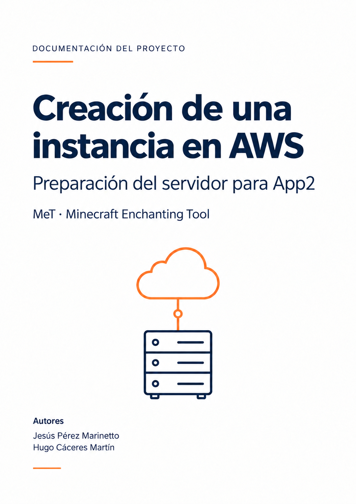

[Versión en PDF](creacion-instancia-aws.pdf)

## Índice

- [1. Acceso a AWS Academy y arranque del laboratorio](#1-acceso-a-aws-academy-y-arranque-del-laboratorio)
- [2. Configuración de la red](#2-configuración-de-la-red)
- [3. Creación del grupo de seguridad](#3-creación-del-grupo-de-seguridad)
- [4. Creación del par de claves SSH](#4-creación-del-par-de-claves-ssh)
  - [4.1. Guardar y proteger la clave en Windows](#41-guardar-y-proteger-la-clave-en-windows)
- [5. Creación de la instancia Ubuntu](#5-creación-de-la-instancia-ubuntu)
  - [5.1. Tipo de instancia y clave de acceso](#51-tipo-de-instancia-y-clave-de-acceso)
  - [5.2. Configuración de red de la instancia](#52-configuración-de-red-de-la-instancia)
  - [5.3. Configuración del almacenamiento](#53-configuración-del-almacenamiento)
  - [5.4. Lanzamiento de la instancia](#54-lanzamiento-de-la-instancia)
- [6. Conexión desde Windows mediante SSH](#6-conexión-desde-windows-mediante-ssh)
  - [6.1. Verificación de la identidad del servidor](#61-verificación-de-la-identidad-del-servidor)
  - [6.2. Primera conexión SSH](#62-primera-conexión-ssh)
  - [6.3. Comprobación del entorno Ubuntu](#63-comprobación-del-entorno-ubuntu)

En este documento explicamos paso a paso cómo crear y preparar una instancia Ubuntu en AWS. Mostramos la configuración de la red, la clave de acceso y la conexión desde Windows mediante SSH.

## 1. Acceso a AWS Academy y arranque del laboratorio

El primer paso es acceder a:

```text
Contenidos Laboratorio para el alumnado → Lanzamiento del Laboratorio para el alumnado de AWS Academy
```

Le damos a **Start Lab** y esperamos a que el indicador de AWS aparezca en verde.

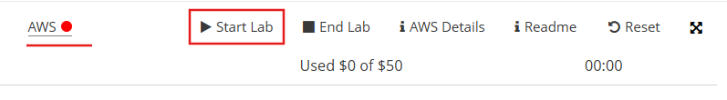

Cuando ya esté así, hacemos clic en él y accedemos a la página de inicio de la consola.


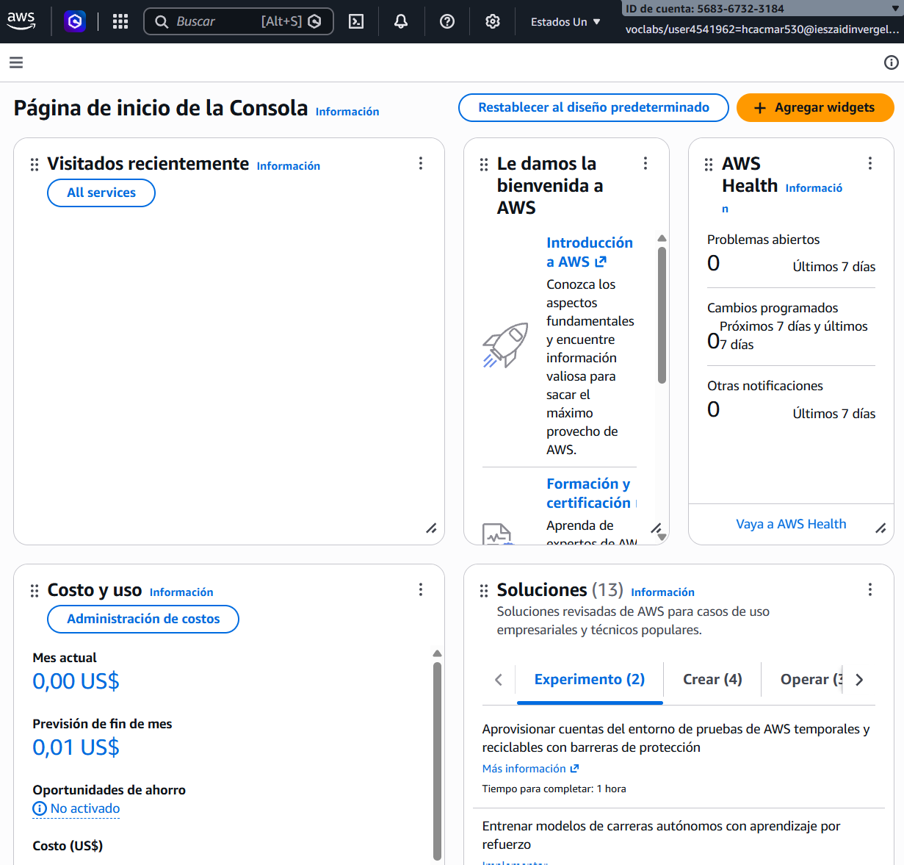

## 2. Configuración de la red

Primero buscamos el servicio VPC.

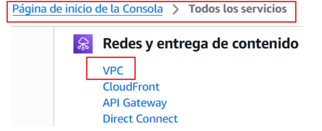

```text
VPC → Tus VPC → Comprobar red existente → Subred y ruta a Internet
```

Utilizamos la VPC predeterminada que ya está disponible en la cuenta.

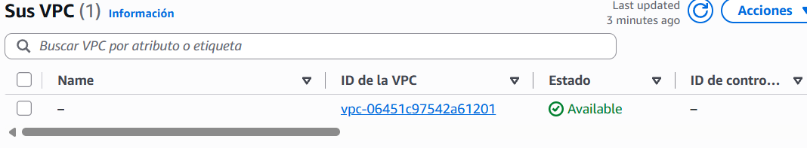

Ahora, en la tabla de rutas, comprobamos que aparece una ruta activa `0.0.0.0/0` con destino a una puerta de enlace a Internet.

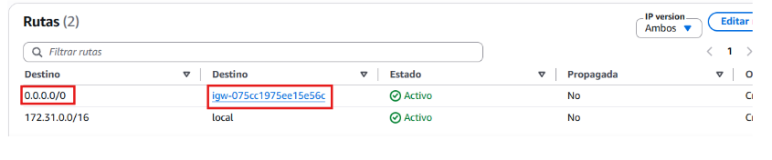

Hacemos clic en el enlace `igw-…` y comprobamos que está conectada a nuestra VPC.

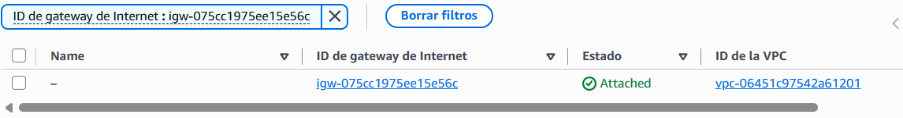

## 3. Creación del grupo de seguridad

Creamos un grupo de seguridad para permitir la conexión SSH a la instancia únicamente desde nuestra IP pública.

```text
VPC → Grupos de seguridad → Crear grupo de seguridad
```

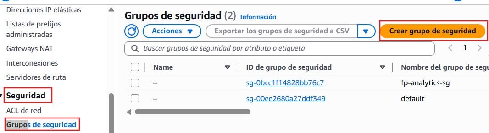

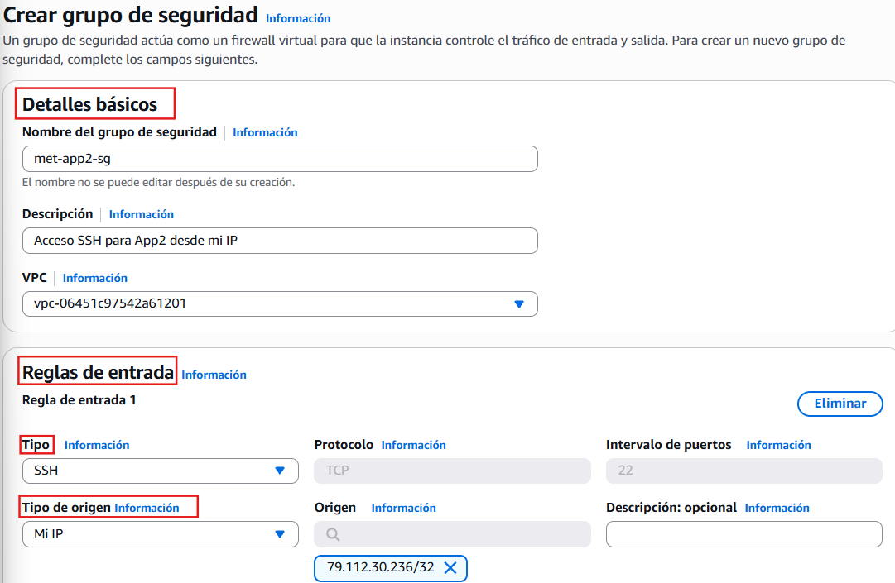

## 4. Creación del par de claves SSH

EC2 es el servicio de AWS que permite crear máquinas virtuales. Lo utilizaremos para alojar App2 y ejecutar sus contenedores Docker.

```text
Buscador de AWS → Escribir EC2 → Abrir EC2
```

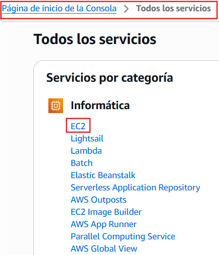

La clave SSH nos permitirá conectarnos a la instancia desde Windows.

```text
Buscador AWS → EC2 → Red y seguridad → Pares de claves → Crear par de claves
```


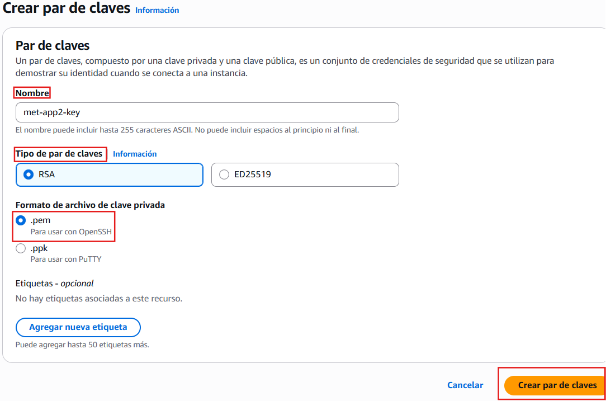

Al crear el par de claves se descarga el archivo `met-app2-key.pem`, que contiene la clave privada. Lo utilizaremos para conectarnos a la instancia por SSH desde Windows. Debemos guardarlo de forma segura y no subirlo al repositorio ni compartirlo.

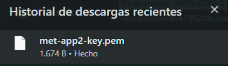

### 4.1. Guardar y proteger la clave en Windows

Guardamos la clave privada en la carpeta `.ssh` de nuestro usuario y restringimos sus permisos para utilizarla en la conexión SSH. En PowerShell ejecutamos estos comandos para proteger el archivo:

```powershell
$keyPath = Join-Path $env:USERPROFILE '.ssh\met-app2-key.pem'
$mySid = [System.Security.Principal.WindowsIdentity]::GetCurrent().User.Value
icacls.exe "$keyPath" /inheritance:r
icacls.exe "$keyPath" /grant:r "*${mySid}:(R)"
icacls.exe "$keyPath"
```

## 5. Creación de la instancia Ubuntu

```text
EC2 → Instancias → Lanzar instancias → Nombre e imagen
```

En nuestro caso:

- **Nombre:** `met-app2`
- **Sistema:** Ubuntu
- **Imagen:** Ubuntu Server 24.04 LTS, oficial de Canonical
- **Arquitectura:** 64 bits (x86)

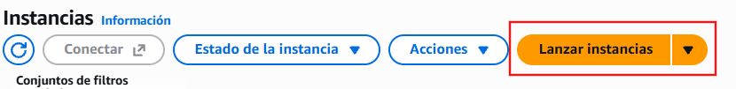

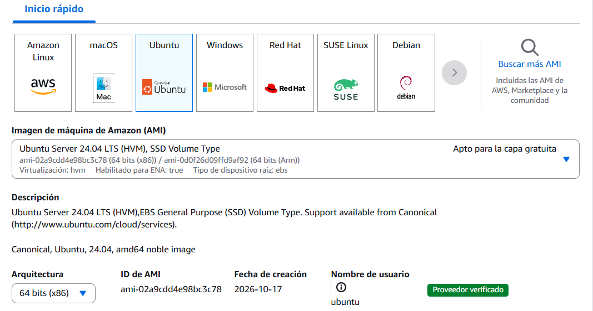

### 5.1. Tipo de instancia y clave de acceso

```text
Tipo de instancia → t2.small → Par de claves → met-app2-key
```


Y el par de claves:

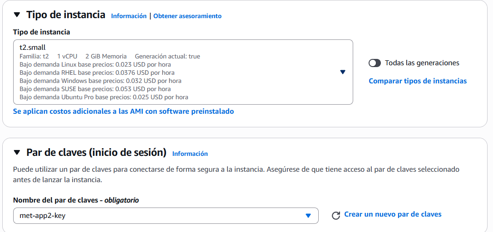

### 5.2. Configuración de red de la instancia

```text
Configuración de red → Editar → VPC y subred → IP pública → Grupo existente
```

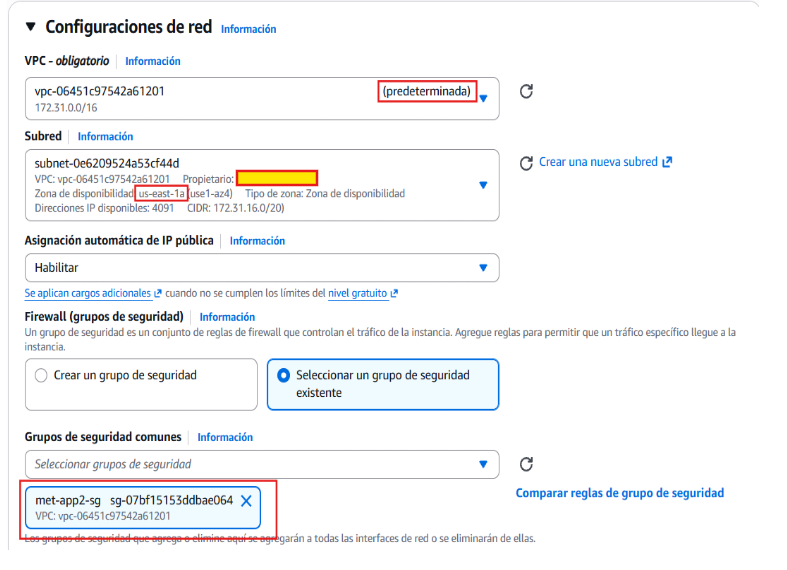

### 5.3. Configuración del almacenamiento

Asignamos espacio en disco para Ubuntu, Docker y las imágenes de App2.

```text
Configurar almacenamiento → Volumen raíz → 16 GiB → gp3
```

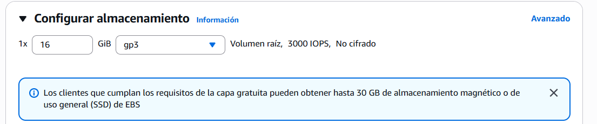

### 5.4. Lanzamiento de la instancia

Revisamos la configuración y lanzamos una única instancia para alojar App2.

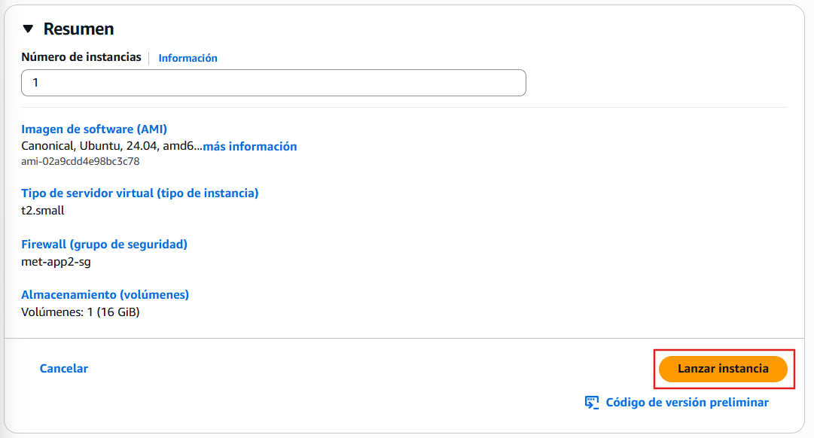

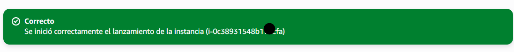

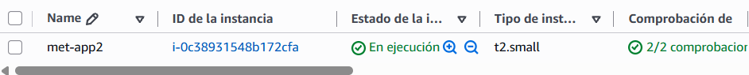

## 6. Conexión desde Windows mediante SSH

Comprobamos que tenemos el cliente SSH y que podemos alcanzar la instancia.

```powershell
ssh -V
Test-NetConnection -ComputerName 3.93.196.119 -Port 22
```

Resultado obtenido:

```text
OpenSSH_for_Windows_9.5p2, LibreSSL 3.8.2

ComputerName     : 3.93.196.119
RemoteAddress    : 3.93.196.119
RemotePort       : 22
InterfaceAlias   : Ethernet
SourceAddress    : 192.168.1.131
TcpTestSucceeded : True
```

### 6.1. Verificación de la identidad del servidor

```text
EC2 → Seleccionar met-app2 → Acciones → Monitorear y solucionar problemas → Obtener registro del sistema
```

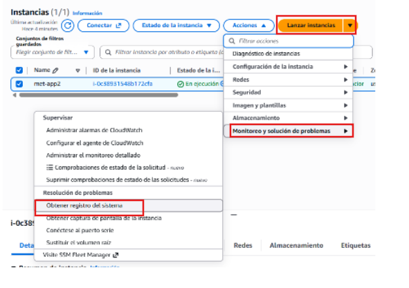

Buscamos la huella SSH en la línea que termina en **ED25519**. Es un código que identifica nuestro servidor. Al conectarnos desde PowerShell, lo compararemos con el que nos muestre para comprobar que estamos entrando en nuestra instancia.

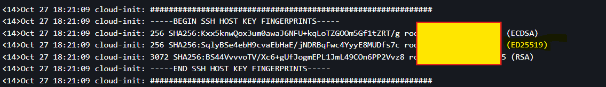

### 6.2. Primera conexión SSH

```text
PowerShell → Conectar por SSH → Comparar huella → Aceptar
```

Ejecutamos:

```powershell
ssh -i "$env:USERPROFILE\.ssh\met-app2-key.pem" ubuntu@3.93.196.119
```

Y ya estamos dentro de la máquina.


### 6.3. Comprobación del entorno Ubuntu

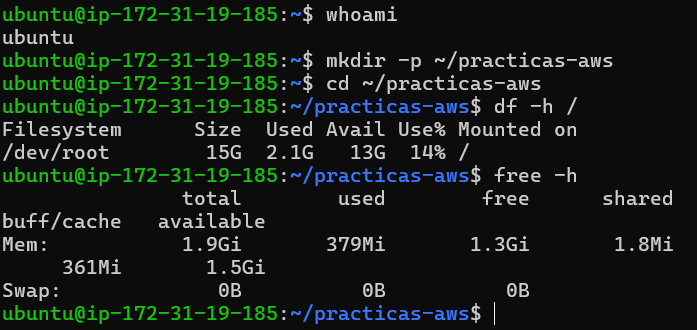
