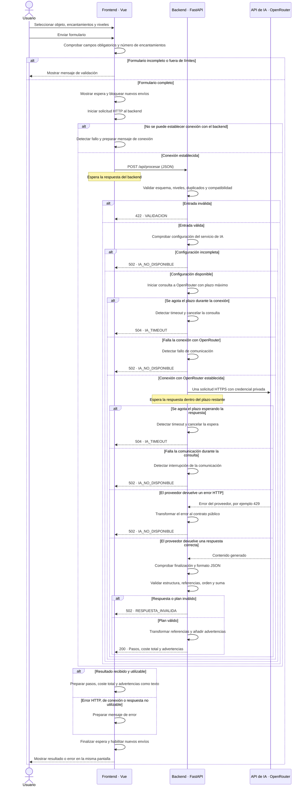

# Diagrama de secuencia del procesamiento de una solicitud

El diagrama representa el flujo de una solicitud en modo real, desde el envío del formulario hasta la presentación del resultado o del error en la misma pantalla.

Si la conexión entre frontend y backend se interrumpe después del envío, el frontend también lo trata como error de comunicación, aunque el backend haya recibido la solicitud. No se realizan reintentos automáticos.

La validación del plan comprueba su estructura y la suma de los costes; no garantiza su exactitud ni un coste mínimo.

[Ver la imagen exportada del diagrama](secuencia-procesamiento.png)